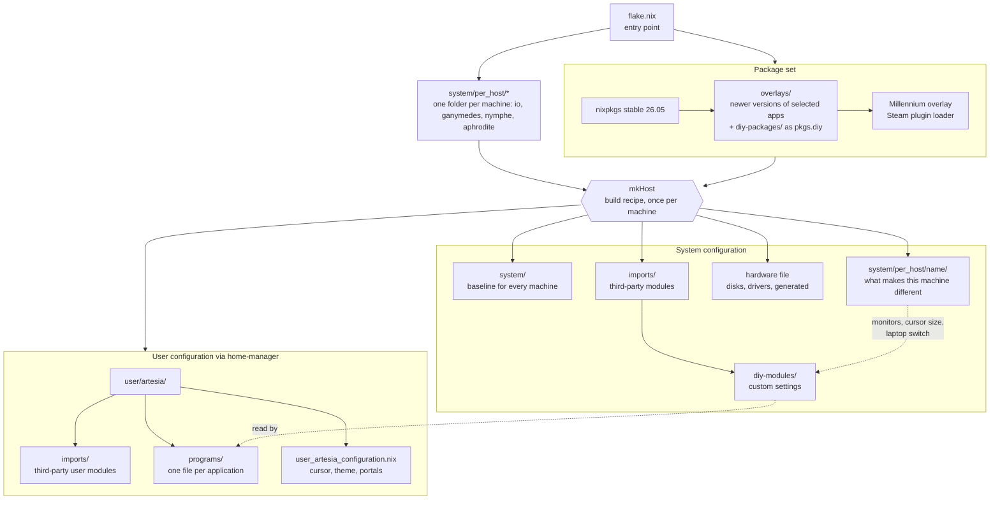
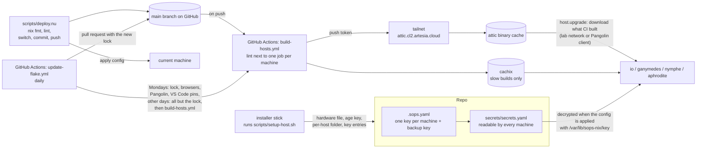

# Structure

How the repo fits together and where a change goes. The procedures (installing, the key stick, Secure Boot) are in the [README](../README.md); the detail of each module is in the comments next to it.

Four things here are not stock NixOS: **attic** is the self-hosted binary cache, **Pangolin** the self-hosted tunnel that publishes it (and other lab services), **noctalia** the desktop shell on top of niri, and **Chaotic Nyx** the third-party package set io takes its CachyOS kernel from.

## How a machine is built

`flake.nix` treats every folder under `system/per_host/` as a host and builds each with `mkHost`. Every host gets the same shared layers; only its hardware file and its own folder differ.

`diy-modules/` and `user/artesia/programs/` import every `.nix` file in their folder, so adding a file is enough. `system/` and `system/per_host/<name>/` list their files explicitly.

## Layers

**`system/`** is the baseline every host gets, split by kind: `configurations`, `packages`, `programs`, `services`.

**`system/per_host/<name>/`** is what makes one host different, in the same four files, plus its generated `hardware-configuration.<name>.nix` (kernel modules and microcode only; disks come from `host.disk`). It can override the baseline and the user layer, as nymphe does for its terminal.

| Host | Type | Compositor | In short |
|---|---|---|---|
| io | desktop | niri | NVIDIA, three monitors, CachyOS LTS kernel, Sunshine, label printer, VM and media tools, ext4, dual boot with Windows |
| ganymedes | laptop | niri and sway | Intel with the GTX 970M on PRIME offload, patched speaker wiring |
| nymphe | laptop | sway | the light one: no xwayland, no game launchers, foot, tablet mode with on-screen keyboard and touch gestures, webcam stream for OBS |
| aphrodite | laptop | niri, Umbriel on trial | encrypted disk on the TPM, Secure Boot, fingerprint unlock, Mullvad, boot animation |

**`diy-modules/`** defines the `host.*` options the per-host files fill in. Machine facts (`host.monitors`, `host.cursor`, `host.dmi`, `host.disk`, `host.gpu`) are stated once per host and read back elsewhere: the niri and sway configs write their output blocks from `host.monitors`, disko takes its layout from `host.disk`, the installer finds the host by `host.dmi`. Feature switches (`host.laptop`, `host.fastboot`, `host.secureboot`, `host.bootsplash`, `host.gaming`, `host.upgrade`) bundle several settings behind one option. `pangolin_client.nix` has no option either and is on everywhere: the Pangolin tray app and the root daemon it talks to, signed in once per user and connected again at every login. Two modules have no option and switch on by a secret being there: `host_backup.nix` backs up `/home/artesia` with restic every day once it holds `<hostname>-restic`, `host_atuin.nix` logs atuin in to the sync server once it holds `atuin`.

**`imports/`** loads the third-party modules (home-manager, sops-nix, disko, lanzaboote, and noctalia and Umbriel from the unstable input) and `diy-modules/`.

**`overlays/`** swaps selected packages for their unstable version, system-wide, and provides `pkgs.diy` from **`diy-packages/`** (software nixpkgs lacks). For an app only one file uses, write `unstable.<name>` there instead.

**`user/artesia/`** is the home-manager layer, the same on every host: one file per application under `programs/`. `niri.nix`, `sway.nix` and `umbriel.nix` only apply where the host enables that compositor. `niri.nix` holds every bind in one table, from which the config, niri's hotkey overlay and the hotkey list in the noctalia launcher are generated. Umbriel has no releases yet: when editing `umbriel.nix`, take keys and actions from the installed binary (`umbriel config schema`, `umbriel msg --help`), not from the website, which describes its main branch.

**`disko/layout.nix`** is the one disk layout: ESP, root, optional swap, mounted by GPT partition label.

**`installer/`** builds the ISO. It carries no configuration: it clones this repo, reads `lib.hostFacts` and runs `scripts/setup-host.sh`.

## Where does a change go?

| Change | File |
|---|---|
| Something every machine should have | `system/system_<kind>.nix` |
| Something only one machine needs | `system/per_host/<name>/<name>_<kind>.nix` |
| A new machine, or a reinstall | boot the installer stick; `scripts/setup-host.sh` for a machine that already runs NixOS |
| The disk layout | `disko/layout.nix`, per-host knobs in `host.disk` |
| A machine fact the user configuration needs | new option in `diy-modules/host_*.nix`, set it per machine, read it in `user/` |
| A feature some machines switch on, with several parts | feature switch in `diy-modules/`, like `host.laptop` |
| An application's own settings | `user/artesia/programs/<application>.nix` |
| Software nixpkgs lacks | `diy-packages/`, plus a line in its `default.nix` |
| A VS Code extension | its Marketplace id in `programs.vscode.marketplaceExtensions`, `system/system_programs.nix`; CI pins the version |
| A newer version of an app on every machine | `overlays/default.nix` |

## Secrets and delivery

**Secrets.** One sops file, encrypted for every host's age key (`/var/lib/sops-nix/key`) and a backup key. A secret switches its own wiring on by being present in the file (`<hostname>-restic`, `atuin`). A host whose key cannot read the file yet logs in with a password hash stored next to the key, until `scripts/rekey.sh` has run on an enrolled host.

**Deploy.** `deploy "message"` (`scripts/deploy.nu`) pulls and rebases onto origin, formats, builds the lint check (`checks.x86_64-linux.lint`), switches the current machine and only then commits and pushes. CI runs the full `nix flake check` next to the builds on that push, builds every host and fills the caches. The other machines follow main by themselves (`host.upgrade`): each evaluates its own system for the newest commit, downloads exactly that store path, which only exists once CI has built it, and makes it the boot default. A machine on a generation made by hand is left alone until `upgrade` is run there. `tests/upgrade.nix` runs that unit in a VM as part of `nix flake check`.

**Updates.** `update-flake.yml` runs daily (04:23 UTC on paper, GitHub has been starting it hours late). On Mondays it bumps `flake.lock`, the two AppImage browsers, the Pangolin tray client and CLI, and the VS Code extension pins. On the other days it leaves the lock alone, apart from the `nix-vscode-extensions` input when a pinned extension moved, and bumps the rest. It builds every host first and opens a pull request only if that passes, so an open PR is known good and merging it is the whole upgrade.

**Cache access.** `attic.cl2.artesia.cloud` resolves to attic directly on the lab network and goes through the Pangolin client from outside; without either the name does not answer. The cache is public to read, so hosts pull without a token; only the push from CI needs one (`ATTIC_TOKEN`). The installer image has neither tailnet nor Pangolin: it gets the slow builds from cachix and builds the rest. The CI runner joins the tailnet as a short-lived `tag:github-ci` device (`TS_OAUTH_*` secrets) and reaches attic there under the same name.
