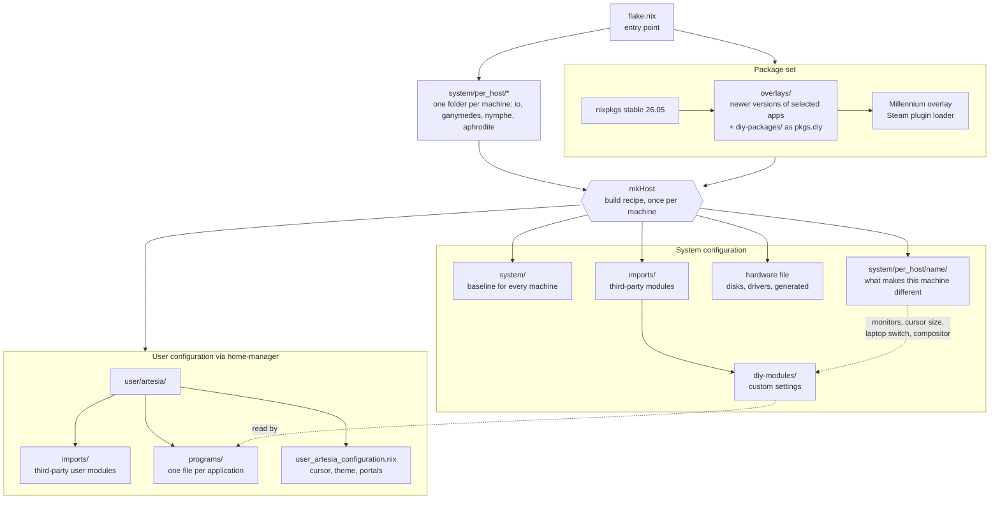
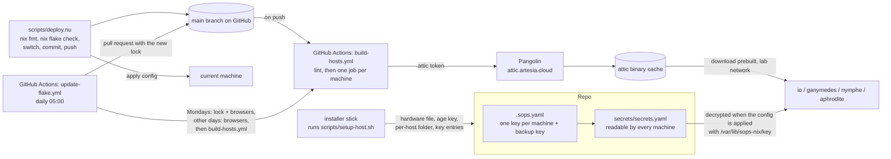

# Structure

How the repo fits together and where a change goes. The procedures (installing, the key stick, Secure Boot) are in the [README](../README.md); the detail of each module is in the comments next to it.

Four things here are not stock NixOS: **attic** is the self-hosted binary cache, **Pangolin** the self-hosted tunnel that publishes it (and other lab services), **noctalia** the desktop shell on top of niri, and **Chaotic Nyx** the third-party package set io takes its CachyOS kernel from.

## How a machine is built

`flake.nix` treats every folder under `system/per_host/` as a host and builds each with `mkHost`. Every host gets the same shared layers; only its hardware file and its own folder differ.

`diy-modules/` and `user/artesia/programs/` import every `.nix` file in their folder, so adding a file is enough. `system/` and `system/per_host/<name>/` list their files explicitly.

## Layers

**`system/`** is the baseline every host gets, split by kind: `configurations`, `packages`, `programs`, `services`.

**`system/per_host/<name>/`** is what makes one host different, in the same four files, plus its generated `hardware-configuration.<name>.nix` (kernel modules and microcode only; disks come from `host.disk`). It can override the baseline and the user layer, as nymphe does for its terminal.

| Host | Type | Compositor | In short |
|---|---|---|---|
| io | desktop | niri | NVIDIA, three monitors, CachyOS LTS kernel, Sunshine, label printer, VM and media tools, ext4, dual boot with Windows |
| ganymedes | laptop | niri and sway | Intel with the GTX 970M on PRIME offload, patched speaker wiring |
| nymphe | laptop | sway | the light one: no xwayland, foot, tablet mode with on-screen keyboard and touch gestures, webcam stream for OBS |
| aphrodite | laptop | niri | encrypted disk on the TPM, Secure Boot, face unlock, Mullvad, boot animation, Pangolin client |

**`diy-modules/`** defines the `host.*` options the per-host files fill in. Machine facts (`host.monitors`, `host.cursor`, `host.dmi`, `host.disk`, `host.gpu`) are stated once per host and read back elsewhere: the niri and sway configs write their output blocks from `host.monitors`, disko takes its layout from `host.disk`, the installer finds the host by `host.dmi`. Feature switches (`host.laptop`, `host.fastboot`, `host.secureboot`, `host.bootsplash`) bundle several settings behind one option. `host_pangolin.nix` has no option: a host connects once `secrets.yaml` holds an entry named `pangolin-<hostname>`.

**`imports/`** loads the third-party modules (home-manager, sops-nix, disko, lanzaboote, noctalia) and `diy-modules/`.

**`overlays/`** swaps selected packages for their unstable version, system-wide, and provides `pkgs.diy` from **`diy-packages/`** (software nixpkgs lacks). For an app only one file uses, write `unstable.<name>` there instead.

**`user/artesia/`** is the home-manager layer, the same on every host: one file per application under `programs/`. `niri.nix` and `sway.nix` only apply where the host enables that compositor.

**`disko/layout.nix`** is the one disk layout: ESP, root, optional swap, mounted by GPT partition label.

**`installer/`** builds the ISO. It carries no configuration: it clones this repo, reads `lib.hostFacts` and runs `scripts/setup-host.sh`.

## Where does a change go?

| Change | File |
|---|---|
| Something every machine should have | `system/system_<kind>.nix` |
| Something only one machine needs | `system/per_host/<name>/<name>_<kind>.nix` |
| A new machine, or a reinstall | boot the installer stick; `scripts/setup-host.sh` for a machine that already runs NixOS |
| The disk layout | `disko/layout.nix`, per-host knobs in `host.disk` |
| A machine fact the user configuration needs | new option in `diy-modules/host_*.nix`, set it per machine, read it in `user/` |
| A feature some machines switch on, with several parts | feature switch in `diy-modules/`, like `host.laptop` |
| An application's own settings | `user/artesia/programs/<application>.nix` |
| Software nixpkgs lacks | `diy-packages/`, plus a line in its `default.nix` |
| A newer version of an app on every machine | `overlays/default.nix` |

## Secrets and delivery

**Secrets.** One sops file, encrypted for every host's age key (`/var/lib/sops-nix/key`) and a backup key. A secret switches its own wiring on by being present in the file (`attic-netrc`, `pangolin-<hostname>`). A host whose key cannot read the file yet logs in with a password hash stored next to the key, until `scripts/rekey.sh` has run on an enrolled host.

**Deploy.** `scripts/deploy.nu` formats, lints, switches the current machine and only then commits and pushes. CI builds every host on that push and fills the cache; the other machines download.

**Updates.** `update-flake.yml` runs daily: lock and browsers on Mondays, browsers only on other days. It builds every host first and opens a pull request only if that passes, so an open PR is known good and merging it is the whole upgrade.

**Cache access.** `attic.artesia.cloud` resolves to attic directly on the lab network and goes through Pangolin from outside. The Pangolin resource is public because attic authenticates everything itself: Nix sends the token as a Basic password from a netrc file, on the hosts (`attic-netrc`), on the CI runner and in the installer (`attic.netrc` on the key stick).
