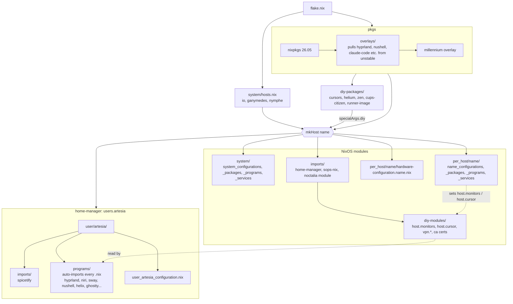
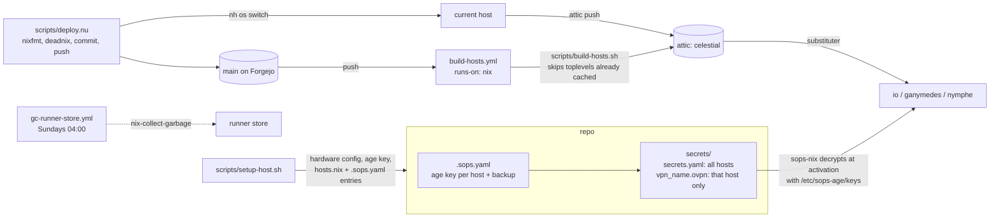

# Structure

## How a host is built

`flake.nix` reads `system/hosts.nix` and calls `mkHost` once per entry. Every host gets the same shared stack; the only per-host inputs are its hardware file and its `per_host/<name>` directory.

`diy-modules/` and `user/artesia/programs/` both import every `.nix` in their directory, so dropping a file in is enough. `system/` and `per_host/<name>/` use explicit import lists.

## What each layer is for

The rule of thumb: shared layers say what every machine has, the per-host layer says what makes this machine different, and the module layers define the knobs the per-host layer turns.

### system/

The baseline every host gets: boot loader, NetworkManager, firewall, locale and timezone, the `artesia` user, pipewire, the display manager, Steam, fonts, nix GC and the attic substituter. Split into four files by kind (`configurations`, `packages`, `programs`, `services`) so you always know which file to open.

### system/per_host/\<name\>/

The shared layer can't know what hardware a machine has or what it is used for, so each host gets its own directory with the same four-file split, plus its generated hardware file. What lives here today:

| Host | Role | What makes it different |
|---|---|---|
| io | desktop | NVIDIA card on the legacy 580 driver with a VRAM cap for niri, three monitors, Sunshine streaming bound to its LAN IP, the Citizen label printer, VM and creative tooling (qemu, Blender, Krita) |
| ganymedes | laptop | single eDP panel, sway + niri, lab VPN and Tailscale on, Cloudflare DNS |
| nymphe | laptop | 1.25 scaling and a smaller cursor, battery work (tlp, thermald, GC only on AC power), hyprland forced off in favour of sway, login password from sops, foot instead of ghostty |

Per-host files can also override the shared layer (`lib.mkForce`, as nymphe does with hyprland) and reach into home-manager through `home-manager.users.artesia`, which is how nymphe swaps terminals without touching `user/`.

`hardware-configuration.<name>.nix` is the output of `nixos-generate-config`: disks, filesystems, kernel modules. It is regenerated, not edited.

### diy-modules/

Custom NixOS options. Without them, a per-host fact like "this laptop has one 1080p panel at 1.25 scale" would have to be repeated in every program that cares, or the shared config would need `if hostname == ...` branches. There are three kinds:

**Data options** (`host.monitors`, `host.cursor`) do nothing on their own. They give the per-host layer a typed place to state a fact, and home-manager reads it back through `osConfig`. This is the only bridge between `per_host/` and `user/`.

**Toggle wrappers** (`vpn.lab_local`, `vpn.tailscale`) bundle several settings behind one `enable`. `vpn.lab_local.enable = true` decrypts `secrets/vpn_<host>.ovpn` with sops and defines an OpenVPN server that uses it. `vpn.tailscale.enable = true` sets up Tailscale with SSH and the operator user, without starting it at boot.

**Always-on** (`ca_certificates.nix`) has no option; it trusts every `.pem`/`.crt` in the private `trusted-certificates` repo on every host.

Example, end to end: `io_configurations.nix` sets three entries in `host.monitors`. `user/artesia/programs/hyprland.nix` loops over that list and pins workspace 1 to `HDMI-A-1`, 2 to `DP-1`, 3 to `DVI-I-1`. nymphe sets one entry and gets one workspace rule, with no hyprland code changed.

### imports/

Third-party NixOS modules: home-manager, sops-nix, and noctalia's module taken from unstable, plus `diy-modules/`. Kept apart from `system/` because these files add options while `system/` only sets them.

### diy-packages/

Packages that aren't in nixpkgs or need repackaging: the Miku and Teto cursors, Helium and Zen browsers, the Citizen CUPS driver from a `.deb`, and the Forgejo runner image. They reach modules as the `diy` argument, e.g. `drivers = [ diy.cups-citizen-ctzcls ]` in io's services. `runner-image` is also a flake output so the CI runner can build it.

### overlays/

Swaps specific packages in `pkgs` for their unstable version: hyprland and its portal, nushell, atuin, noctalia, claude-code and a few others. Because it changes `pkgs` itself, every reference to `pkgs.hyprland` anywhere in the repo gets the unstable build. For a one-off unstable package, use the `unstable` argument instead of growing this list.

### user/artesia/

home-manager: one file per program under `programs/` (shell, editor, compositors, terminal, git, ssh), the spicetify module under `imports/`, and session-level settings like cursor theme in `user_artesia_configuration.nix`. It is identical on every host; anything host-specific comes in through `osConfig.host.*` or a per-host override.

### Where does a change go?

| Change | File |
|---|---|
| Something every machine should have | `system/system_<kind>.nix` |
| Something only one machine needs | `system/per_host/<name>/<name>_<kind>.nix` |
| A per-host fact that user config needs to read | new option in `diy-modules/host_*.nix`, set it in `per_host`, read via `osConfig` |
| A feature some hosts turn on with several moving parts | toggle wrapper in `diy-modules/` |
| A program's own settings | `user/artesia/programs/<program>.nix` |
| A package nixpkgs doesn't have | `diy-packages/` + entry in its `default.nix` |
| A newer version of a package everywhere | `overlays/default.nix` |

## Secrets and delivery

The `trusted-certificates` input is a private repo on `git.artesia.cloud`, which is why CI rewrites the SSH URL to HTTPS with `FLAKE_TOKEN` and switches to the lab resolver before checkout.
