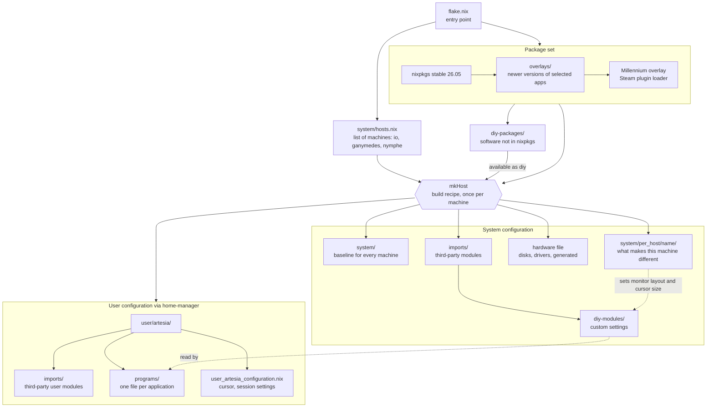
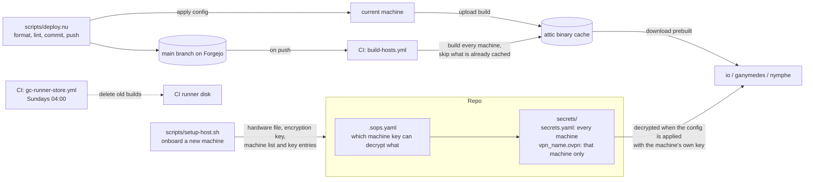

# Structure

This repo is the complete configuration for my Linux machines. Each machine runs NixOS, a Linux distribution where the whole system is described in code: installed software, services, users, desktop settings and dotfiles. Applying the repo to a machine builds that description and switches to it, so every machine can be rebuilt from scratch to the same state, and every change is a git commit that can be rolled back.

## Terms used in this document

| Term | What it is |
|---|---|
| Nix | The package manager and configuration language everything here is written in. Files end in `.nix`. |
| nixpkgs | The official Nix package collection. "Stable" is the twice-yearly release (26.05 here), "unstable" is the rolling branch with newer versions. |
| Module | A `.nix` file that sets configuration values, or defines new settings other files can set. NixOS merges all modules into one system configuration. |
| Flake | The entry point of a Nix project (`flake.nix`). Declares external dependencies with pinned versions (`flake.lock`) and what the project builds. |
| home-manager | A Nix tool for the user's own settings and dotfiles (shell, editor, terminal), as opposed to system-wide settings. |
| Overlay | A rule that replaces packages in the package set, for example "use the unstable version of this app instead of the stable one". |
| sops / age | Encryption for secrets stored in git. Each machine has its own private key and can only decrypt the files it is allowed to. |
| attic | A self-hosted binary cache. Machines download finished builds from it instead of compiling locally. |
| Forgejo | The self-hosted git server this repo lives on, with GitHub Actions-style CI. |
| Wayland compositor | The component that draws windows and handles input on a modern Linux desktop. Hyprland, niri and sway are three different ones, each with its own way of tiling windows. |
| noctalia | The desktop shell on top of the compositor: status bar, app launcher, notifications. |

## How a machine is built

`flake.nix` reads the list of machines in `system/hosts.nix` and builds each one with the same recipe (`mkHost`). Every machine gets the same shared layers; the only things that differ are its hardware file and its own folder under `system/per_host/`.

`diy-modules/` and `user/artesia/programs/` load every `.nix` file in their folder automatically, so adding a file is enough. `system/` and `system/per_host/<name>/` list their files explicitly.

## What each layer is for

The short version: the shared layers describe what every machine has, the per-machine layer describes what makes one machine different, and the custom modules define the settings the per-machine layer fills in.

### system/: the baseline

What every machine gets regardless of hardware: boot loader, networking and firewall, timezone and language, the `artesia` user account, audio, Bluetooth, the login screen, Steam, fonts, automatic cleanup of old builds, and the address of the binary cache.

It is split into four files by kind so it is always clear where something lives: `configurations` (general system settings), `packages` (installed software), `programs` (applications that need system integration, such as Steam or a compositor) and `services` (background daemons).

### system/per_host/\<name\>/: per machine

The baseline cannot know what hardware a machine has or what it is used for, so each machine has its own folder with the same four-file split. This is where a desktop and a laptop diverge:

| Machine | Type | What makes it different |
|---|---|---|
| io | desktop | NVIDIA graphics card with a driver tweak to limit video memory use, three monitors, Sunshine (a remote desktop and game streaming server) reachable on its LAN address, a USB label printer, virtual machine tools, 3D and image editing software |
| ganymedes | laptop | single built-in screen, uses the lab VPN and Tailscale (a mesh VPN), fixed public DNS servers |
| nymphe | laptop | screen scaled to 125%, smaller mouse cursor, battery and thermal management, cleanup tasks only run on mains power, login password stored as an encrypted secret, a lighter terminal and compositor than the other machines |

A per-machine file can also override the baseline. nymphe, for example, turns off the Hyprland compositor that the baseline enables and changes its user's terminal, without touching the shared files.

Each folder also holds `hardware-configuration.<name>.nix`. It is generated by the NixOS installer and describes disks, filesystems and kernel drivers. It gets regenerated, not edited by hand.

### diy-modules/: custom settings

NixOS comes with thousands of settings, but none for facts like "this laptop has one 1080p screen at 125% scale". Without a place to record that, every application that cares about screens would need its own per-machine copy of it, or the shared files would fill up with "if machine is X" checks. These modules add the missing settings. There are three kinds:

**Machine facts** (`host.monitors`, `host.cursor`) do nothing by themselves. They give each machine a single, validated place to state a fact, and the user configuration reads it back. This is the only link between the per-machine layer and the user layer.

**Feature switches** (`vpn.lab_local`, `vpn.tailscale`) bundle several related settings behind one on/off switch. Turning on `vpn.lab_local` decrypts that machine's VPN profile and sets up an OpenVPN connection that uses it. Turning on `vpn.tailscale` installs Tailscale with SSH access and user permissions configured, but does not start it at boot.

**Always on** (`ca_certificates.nix`) has no switch. It makes every machine trust the internal certificate authorities kept in a separate private repo, so internal HTTPS services work without browser warnings.

An example from start to finish: io's per-machine file lists three monitors. The Hyprland config in `user/artesia/programs/` reads that list and assigns workspace 1 to the first monitor, 2 to the second and 3 to the third. nymphe lists one monitor and gets one workspace. The Hyprland file is the same on both.

### imports/: third-party modules

Modules written by other projects: home-manager (user configuration), sops-nix (secret decryption) and the noctalia desktop shell module. It also loads `diy-modules/`. Kept apart from `system/` because these files define new settings, while `system/` only fills settings in.

### diy-packages/: software not in nixpkgs

Applications that the official package collection does not have, or not in a usable form: two custom mouse cursor themes, the Helium and Zen web browsers, a printer driver for the Citizen label printer repackaged from the vendor's `.deb`, and a container image for the CI runner. Configuration files refer to them as `diy.<name>`, for example io's printer setup uses `diy.cups-citizen-ctzcls`.

### overlays/: newer versions of selected apps

The machines run the stable package collection, which only gets security and bug fixes between releases. For a few applications that move fast or where newer features matter, this overlay swaps in the version from the unstable branch instead. Because it replaces the package for the whole system, every place that refers to it gets the newer version, with no changes needed elsewhere.

Currently swapped: the Hyprland compositor and its related tools, the nushell shell, atuin (shell history sync), flameshot (screenshots), the noctalia desktop shell, the Bitwarden password manager, two AI coding assistants (Claude Code and opencode) and the Pangolin tunnel client.

For a single application that only one config file uses, refer to it as `unstable.<name>` in that file instead of adding it here.

### user/artesia/: the user's own settings

Everything home-manager manages for the `artesia` user: one file per application under `programs/` (shell, text editor, terminal, compositors, git, SSH), the Spotify theming module under `imports/`, and the mouse cursor theme in `user_artesia_configuration.nix`. This layer is the same on every machine. Machine-specific values come in through the custom settings above, or through an override in the machine's own folder.

### Where does a change go?

| Change | File |
|---|---|
| Something every machine should have | `system/system_<kind>.nix` |
| Something only one machine needs | `system/per_host/<name>/<name>_<kind>.nix` |
| A machine fact the user configuration needs | new setting in `diy-modules/host_*.nix`, set it per machine, read it in `user/` |
| A feature some machines switch on, with several parts | feature switch in `diy-modules/` |
| An application's own settings | `user/artesia/programs/<application>.nix` |
| Software the official collection lacks | `diy-packages/`, plus a line in its `default.nix` |
| A newer version of an app on every machine | `overlays/default.nix` |

## Secrets and delivery

Secrets are stored encrypted in git. `.sops.yaml` lists each machine's public key and which secret files it may read: the shared `secrets.yaml` is readable by every machine, each VPN profile only by its own machine. A backup key can read everything, so secrets survive a lost machine.

A normal change goes through `deploy.nu`: format and check the Nix files, commit, push, apply the new configuration to the current machine and upload the result to the cache. The push also triggers CI, which builds every machine's configuration and uploads anything not yet cached. When another machine updates, it downloads those builds instead of compiling them itself.

The certificate repo (`trusted-certificates`) is private and only reachable on the lab network, which is why CI first switches to the lab's DNS server and uses an access token to fetch it.
