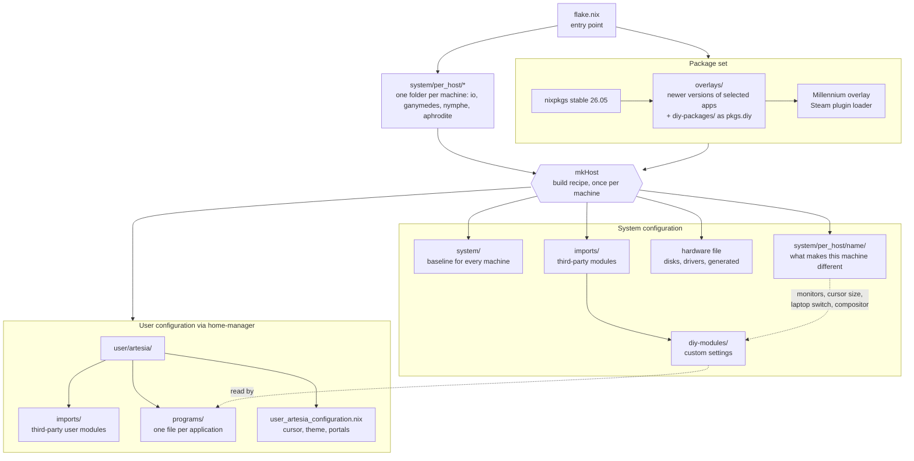
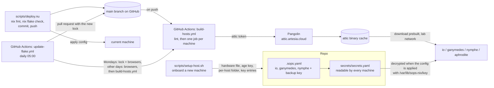

# Structure

This repo is the complete configuration for my Linux machines. Each machine runs NixOS, a Linux distribution where the whole system is described in code: installed software, services, users, desktop settings and dotfiles. Applying the repo to a machine builds that description and switches to it, so every machine can be rebuilt from scratch to the same state, and every change is a git commit that can be rolled back.

## Terms used in this document

| Term | What it is |
|---|---|
| Nix | The package manager and configuration language everything here is written in. Files end in `.nix`. |
| nixpkgs | The official Nix package collection. "Stable" is the twice-yearly release (26.05 here), "unstable" is the rolling branch with newer versions. |
| Module | A `.nix` file that sets configuration values, or defines new settings other files can set. NixOS merges all modules into one system configuration. |
| Flake | The entry point of a Nix project (`flake.nix`). Declares external dependencies with pinned versions (`flake.lock`) and what the project builds. |
| home-manager | A Nix tool for the user's own settings and dotfiles (shell, editor, terminal), as opposed to system-wide settings. |
| Overlay | A rule that changes the package set, for example "use the unstable version of this app" or "add these extra packages". |
| sops / age | Encryption for secrets stored in git. Each machine has its own private key and can only decrypt the files it is allowed to. |
| attic | A self-hosted binary cache. Machines download finished builds from it instead of compiling locally. |
| GitHub Actions | The CI that builds every machine on every push, on GitHub's own runners. |
| Pangolin | A self-hosted tunnel that publishes lab services on the internet. Attic is reachable through it. |
| Wayland compositor | The component that draws windows and handles input on a modern Linux desktop. niri (scrolling columns) and sway (classic tiling) are the two used here. |
| noctalia | The desktop shell on top of niri: status bar, app launcher, notifications, lock screen, wallpaper rotation. |
| Tailscale | A mesh VPN. The daemon runs on every machine, joining the network is a manual step. |
| disko | Declarative disk partitioning. Describes the disk layout in Nix and can format a disk from that description. |
| Chaotic Nyx | A third-party Nix package set with a binary cache. Used for the CachyOS kernel on io. |

## How a machine is built

`flake.nix` treats every folder under `system/per_host/` as a machine and builds each with the same recipe (`mkHost`). Every machine gets the same shared layers; the only things that differ are its hardware file and its own folder.

`diy-modules/` and `user/artesia/programs/` load every `.nix` file in their folder automatically, so adding a file is enough. `system/` and `system/per_host/<name>/` list their files explicitly.

## What each layer is for

The short version: the shared layers describe what every machine has, the per-machine layer describes what makes one machine different, and the custom modules define the settings the per-machine layer fills in.

### system/: the baseline

What every machine gets regardless of hardware: boot loader, networking and firewall, timezone and language, the `artesia` user account, audio, Bluetooth, the login screen, Steam, fonts, Tailscale, automatic cleanup of old builds, the sops key location and the address of the binary cache.

It is split into four files by kind so it is always clear where something lives: `configurations` (general system settings), `packages` (installed software), `programs` (applications that need system integration, such as Steam or a compositor) and `services` (background daemons).

### system/per_host/\<name\>/: per machine

The baseline cannot know what hardware a machine has or what it is used for, so each machine has its own folder with the same four-file split. This is where a desktop and a laptop diverge:

| Machine | Type | Compositor | What makes it different |
|---|---|---|---|
| io | desktop | niri | NVIDIA graphics card with a driver tweak to limit video memory use, three monitors, Sunshine (a remote desktop and game streaming server) reachable on its LAN address, a USB label printer, virtual machine tools, 3D and image editing software, the CachyOS LTS kernel from Chaotic Nyx, ext4 root, a 3 second boot menu for its Windows entry |
| ganymedes | laptop | niri and sway | single built-in screen, laptop power management, fixed public DNS servers, an HD-audio pin patch for its Acer Predator speaker wiring (headphone jack sense off, right pair and subwoofers enabled) and a pinned 4.0 + microphone audio profile, Intel for the desktop with the GTX 970M on PRIME offload |
| nymphe | laptop | sway only | built to run on very little: no xwayland, foot instead of ghostty, waybar and fuzzel instead of noctalia, no Discord presence in the background, screen scaled to 125%, smaller cursor, laptop power management |
| aphrodite | laptop | niri | single built-in screen, AMD so no thermald, laptop power management |

A per-machine file can also override the baseline. nymphe, for example, swaps its user's terminal and turns off a few user services, without touching the shared files.

Each folder also holds `hardware-configuration.<name>.nix`. It is generated by `nixos-generate-config --no-filesystems` and only describes kernel modules and CPU microcode; disks and mounts come from `host.disk` and disko. It gets regenerated, not edited by hand.

### diy-modules/: custom settings

NixOS comes with thousands of settings, but none for facts like "this laptop has one 1080p screen at 125% scale". Without a place to record that, every application that cares about screens would need its own per-machine copy of it, or the shared files would fill up with "if machine is X" checks. These modules add the missing settings. There are two kinds:

**Machine facts** (`host.monitors`, `host.cursor`, `host.dmi`, `host.disk`, `host.gpu`) do nothing by themselves. They give each machine a single, validated place to state a fact, and the user configuration reads it back. This is the main link between the per-machine layer and the user layer. `host.disk` (btrfs or ext4, swap and ESP size) feeds `disko/layout.nix`, the single disk layout every machine uses: an ESP, the root and, unless `host.disk.swapSize` is null, a swap partition, mounted by GPT partition label so the hardware files no longer carry filesystems. `host.dmi` is how the installer recognises a machine. `host.gpu` (intel, amd or nvidia) picks the graphics drivers and hardware video decode: the Intel media drivers on the Intel laptops, Mesa on aphrodite, the NVIDIA stack on io, and the matching `LIBVA_DRIVER_NAME` so browsers and mpv decode video on the GPU. ganymedes is Intel for the desktop with its GTX 970M reachable through `nvidia-offload <command>` (PRIME offload; Maxwell cannot power the card down under the proprietary driver, so it idles at a few watts).

**Feature switches** (`host.laptop`, `host.fastboot`) bundle several related settings behind one on/off switch. Turning on `host.laptop` enables TLP for battery life, zram swap, and makes the weekly store cleanup and optimisation wait for mains power. TLP's `tlp-pd` provides the power-profiles-daemon interface, so the power profile widgets in noctalia and waybar keep working and the real power-profiles-daemon is turned off. `host.laptop.thermald` is on by default and off on AMD machines. `host.fastboot` trades the classic boot path for the newer one: nixos-init instead of the perl activation script, an immutable `/etc` built in the initrd, userborn for user accounts, no boot menu delay and the boot partition mounted on demand. Every host runs it; io keeps a 3 second boot menu for its Windows entry.

An example from start to finish: io's per-machine file lists three monitors. The niri config in `user/artesia/programs/` reads that list and writes one `output` block per monitor with its mode, position and scale. nymphe lists one monitor and gets one block. The niri file is the same on both.

### imports/: third-party modules

Modules written by other projects: home-manager (user configuration), sops-nix (secret decryption), disko (disk layout) and the noctalia desktop shell module. It also loads `diy-modules/`. Kept apart from `system/` because these files define new settings, while `system/` only fills settings in.

### diy-packages/: software not in nixpkgs

Applications that the official package collection does not have, or not in a usable form: two custom mouse cursor themes, the Helium and Zen web browsers, and a CUPS driver for the Citizen label printer built from the vendor's source tarball. The overlay exposes them as `pkgs.diy.<name>`, for example io's printer setup uses `pkgs.diy.cups-citizen-ctzcls`. `scripts/update-appimages.sh` bumps the two browsers to their latest release.

### overlays/: newer versions of selected apps

The machines run the stable package collection, which only gets security and bug fixes between releases. For a few applications that move fast or where newer features matter, this overlay swaps in the version from the unstable branch instead. Because it replaces the package for the whole system, every place that refers to it gets the newer version, with no changes needed elsewhere. The same overlay is where `pkgs.diy` comes from, and it exposes `niri-float-sticky`, a flake input, as a normal package.

Currently swapped: the nushell shell, atuin (shell history sync), flameshot (screenshots), hyprpicker (colour picker), the noctalia desktop shell, the Bitwarden password manager, two AI coding assistants (Claude Code and opencode) and the Pangolin tunnel client.

For a single application that only one config file uses, refer to it as `unstable.<name>` in that file instead of adding it here.

### user/artesia/: the user's own settings

Everything home-manager manages for the `artesia` user: one file per application under `programs/` (shell, text editor, terminal, compositors, git, SSH), the Spotify theming module under `imports/`, and the mouse cursor theme, GTK theme and desktop portals in `user_artesia_configuration.nix`. This layer is the same on every machine. Machine-specific values come in through the custom settings above, or through an override in the machine's own folder.

The two compositor files are gated on the host: `niri.nix` only applies where the machine enables `programs.niri`, `sway.nix` only where it enables `programs.sway`. niri starts noctalia; sway brings its own waybar, fuzzel, mako and swaylock. Both know the same keys (Super+Q terminal, Super+E files, Super+C close, Super+Space launcher, Super+L lock, Super+V float, Super+M quit, media and brightness keys, Print for a screenshot). Screenshots differ: niri uses its own screenshot UI on Print (region across any monitor, clipboard and `~/Pictures/Screenshots`) and Shift+Print for grim, slurp and satty when the shot needs annotating; sway uses flameshot through the wlr portal and floats its capture window over the whole screen. flameshot only runs where sway is enabled, because niri's portal screenshot path handles a single output and io has three.

niri has no sticky windows (a floating window belongs to its workspace) and it stops sending frame callbacks to windows on other workspaces, so a hidden film redraws about once a second and a Discord stream of it arrives at that rate. The way round both is to keep the window on screen: Super+P puts the focused window in picture-in-picture mode, a 960x540 float in the bottom-right corner that the `niri-float-sticky` daemon (a flake input) carries along on every workspace switch; Super+P again tiles it back. Bare mpv and browser picture-in-picture windows stick on their own. The window a screencast is targeting gets a thin red border. Bitwarden popouts (unlock, passkey picker) float centred instead of taking a column; Firefox sets the title after the window appears, so a small watcher on the niri event stream floats them when the title arrives.

### Performance choices

Every machine runs the `scx_lavd` sched_ext scheduler (built for interactive and gaming loads) and `ananicy-cpp` with the CachyOS rules, which renices compilers, Steam and browsers below the compositor. io additionally runs the CachyOS LTS kernel from Chaotic Nyx, prebuilt from their cache; the NVIDIA 580 modules for it are built locally since the cache only carries the current NVIDIA branch. `host.fastboot` is on everywhere (io keeps a 3 second boot menu for the Windows entry) and home-manager activates as a user service at login rather than during the switch. The machines no longer push to the cache; CI does, so `attic-watch-store` and the push in `deploy.nu` are gone, and the weekly store optimisation replaced the daily one.

### installer/: the stick

`nix build .#installer-iso` produces a bootable image with this repo embedded; CI builds it on every change to the installer, the disk layout or the lock and publishes it as the rolling `installer` GitHub release (the tag moves to the commit it was built from, the ISO and its sha256 replace the previous ones). On boot it reads the machine's DMI product name, finds the host whose `host.dmi` lists it, shows the internal disk it will wipe, waits 15 seconds for an abort, waits for network, runs disko with that host's `host.disk` values, puts an age key in place (from a stick labelled `CELESTIAL_KEYS` if one holds `keys/<host>.key`, otherwise freshly generated), runs `nixos-install` from the embedded flake and reboots. Unknown machines get a prompt instead of a wipe. A generated key cannot decrypt `secrets.yaml` yet, so in that case the installer asks for a login password once; adding the printed public key to `.sops.yaml` hands the password over to the secret afterwards.

Every host's login password now comes from `secrets.yaml` (`artesia-password`), which is what makes an unattended install bootable into a usable machine. Hosts installed before disko need `sudo nix shell nixpkgs#gptfdisk -c scripts/label-disk.sh` run once, before switching, so their partitions carry the labels the new mount table expects; switching first leaves the next boot waiting for `disk-main-root`, recoverable by booting the previous generation (hold Space for the menu on fastboot hosts) and labelling then.

### Where does a change go?

| Change | File |
|---|---|
| Something every machine should have | `system/system_<kind>.nix` |
| Something only one machine needs | `system/per_host/<name>/<name>_<kind>.nix` |
| A new machine | a folder under `system/per_host/`, via `scripts/setup-host.sh`; reinstall an existing one from the stick |
| The disk layout | `disko/layout.nix`, per-host knobs in `host.disk` |
| A machine fact the user configuration needs | new setting in `diy-modules/host_*.nix`, set it per machine, read it in `user/` |
| A feature some machines switch on, with several parts | feature switch in `diy-modules/`, like `host.laptop` |
| An application's own settings | `user/artesia/programs/<application>.nix` |
| Software the official collection lacks | `diy-packages/`, plus a line in its `default.nix` |
| A newer version of an app on every machine | `overlays/default.nix` |

## Secrets and delivery

Secrets are stored encrypted in git. `.sops.yaml` lists each machine's public key; the single secrets file is readable by every machine, and a backup key can read everything so secrets survive a lost machine. Every machine keeps its private key at `/var/lib/sops-nix/key`. One secret is in use on every machine, the login password; the attic pull token (`attic-netrc`) is wired in automatically once it is added to the file. aphrodite's key still needs adding to `.sops.yaml`.

A normal change goes through `deploy.nu`: `nix fmt` formats, `nix flake check` runs deadnix and a format check, then commit, push and apply the new configuration to the current machine. The push triggers CI, which runs the same check, then builds each machine in its own job and uploads anything not yet cached. When another machine updates, it downloads those builds instead of compiling them itself.

Dependency updates are CI's job too. `update-flake.yml` runs every day at 05:00 UTC. On Mondays it runs `nix flake update` and `scripts/update-appimages.sh` together (branch `update/flake-lock`), on the other days only the browser script (branch `update/browsers`; the Helium and Zen browsers are not in nixpkgs, so their AppImage versions live in `diy-packages/`). Each pushes its result, runs the same build for every machine and only then opens a pull request listing what changed. Pull requests you open yourself get the same build, minus the push to the cache. If the build fails there is no pull request, only a red run. Merging the pull request is the whole upgrade; the machines download what CI already built.

### How CI reaches the cache

The machines are on the lab network, where `attic.artesia.cloud` resolves to the attic server directly. GitHub's runners are not, so the same name is also published through Pangolin as a public resource: no Pangolin login in front of it, because attic authenticates everything itself. The cache is private: reads and pushes both need an attic token. Nix cannot send bearer tokens, but attic accepts the token as an HTTP Basic password, so every machine will carry one line, `machine attic.artesia.cloud password <pull token>`, as the sops secret `attic-netrc`, wired into Nix's `netrc-file` (switched on by the presence of that entry in `secrets.yaml`, not there yet). CI writes the same line to `/etc/nix/netrc` on the runner and logs the attic client in with the push-capable token (`.github/actions/attic`). The installer pulls from attic when the key stick carries an `attic.netrc`, otherwise it builds what the public caches lack.

Repository secret: `ATTIC_TOKEN`, an attic token with pull and push rights on the `celestial` cache. Optional repository variable `ATTIC_PUBLIC_URL` overrides the hostname.
