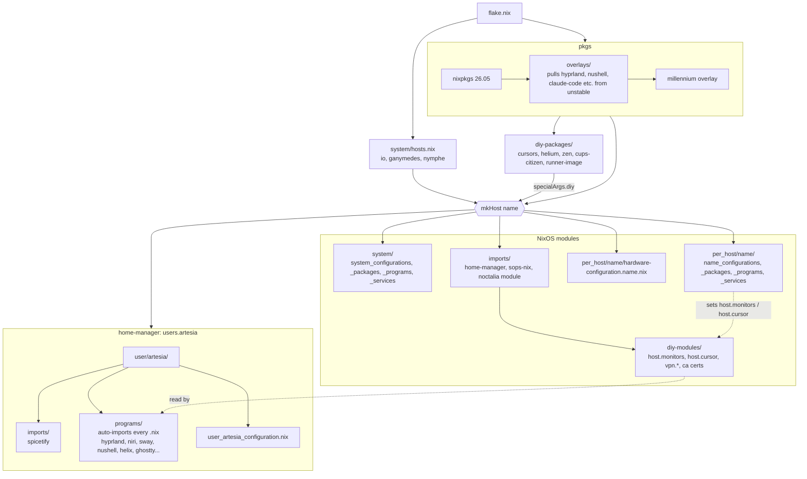
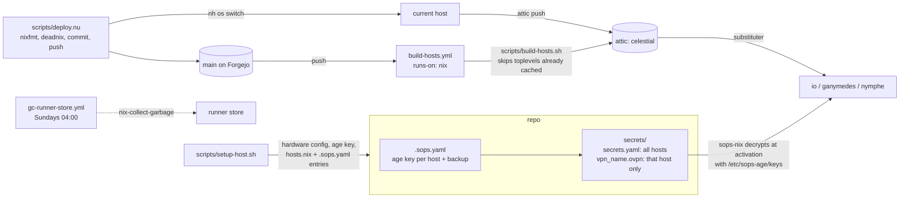

# Structure

## How a host is built

`flake.nix` reads `system/hosts.nix` and calls `mkHost` once per entry. Every host gets the same shared stack; the only per-host inputs are its hardware file and its `per_host/<name>` directory.

`diy-modules/` and `user/artesia/programs/` both import every `.nix` in their directory, so dropping a file in is enough. `system/` and `per_host/<name>/` use explicit import lists.

## Secrets and delivery

The `trusted-certificates` input is a private repo on `git.artesia.cloud`, which is why CI rewrites the SSH URL to HTTPS with `FLAKE_TOKEN` and switches to the lab resolver before checkout.
